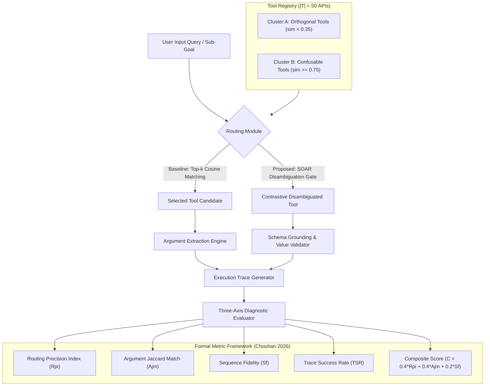

# Experiment Blueprint: Frozen Evaluation Protocol

**Study Title**: Overlap-Aware Routing and Grounding Verification in Multi-Tool Agentic AI  
**Author**: Bharat Chouhan (MHM2026005)  
**Date**: 2026-11-17  
**Protocol Status**: **FROZEN PRIOR TO RESULTS GENERATION**  

---

## 1. System Architecture & Information Flow



---

## 2. Input / Output Definitions & Schemas

### Tool Definition Schema
Each tool $t \in \mathcal{T}$ is formally defined as:
```json
{
  "name": "string (unique identifier)",
  "category": "string (finance, ecommerce, crm, system, data)",
  "description": "string (natural language specification)",
  "parameters": {
    "param_name": {
      "type": "string | integer | float | boolean",
      "required": true,
      "description": "string"
    }
  },
  "confusable_with": ["string (names of overlapping tools)"]
}
```

### Trace Episode Schema
Each test episode $e_i \in \mathcal{E}$ specifies:
- `episode_id`: Unique integer.
- `prompt`: Natural language task instruction.
- `horizon_L`: Target trace step length ($L \in \{1, 2, 3, 5, 7, 10\}$).
- `ground_truth_actions`: Ordered sequence of valid calls: `[{"tool": name, "arguments": {...}}, ...]`.
- `overlap_condition`: `"orthogonal"` vs `"confusable"`.

---

## 3. Evaluated Methods & Comparators

1. **Method 0 (Random/Naive Baseline)**:
   - Uniformly selects tools matching broad lexical keywords; no parameter validation.
2. **Method 1 (Standard Retriever Baseline - Top-$k$ Cosine Similarity)**:
   - Encodes tool documentation and query via TF-IDF / term-frequency vectorizer; greedily picks top-1 matching tool; extracts arguments via dictionary pattern match without type/entity grounding check.
3. **Method 2 (Targeted Extension: SOAR - Semantic-Overlap-Aware Routing & Grounding)**:
   - **Contrastive Disambiguation**: When top-2 candidate tools exhibit similarity margin $\Delta < \theta_{\text{margin}}$, computes contrastive keyword specificity over distinguishing schema parameters to break tie.
   - **Grounding Gate**: Asserts that every mandatory parameter key is present in user context and matches declared type before execution; sets fallback flag if entity is ungrounded (preventing failure $P_3$).

---

## 4. Formal Evaluation Metrics (Directions & Formulae)

| Metric | Full Name | Evaluation Target | Formula | Range & Optimal |
|:---|:---|:---|:---|:---|
| **$R_{pi}$** | Routing Precision Index | Tool name set Jaccard agreement | $\frac{\|A \cap P\|}{\|A \cup P\|}$ | $[0.0, 1.0]$ (Higher is better) |
| **$A_{jm}$** | Argument Jaccard Match | Key-value grounding agreement | $\frac{\sum_{i \in K_a \cap K_p} \mathbb{I}[v_{\text{act}} = v_{\text{pred}}]}{\|K_a \cup K_p\|}$ | $[0.0, 1.0]$ (Higher is better) |
| **$S_f$** | Sequence Fidelity | Normalized Levenshtein distance | $1 - \frac{\text{Lev}(A, P)}{\max(\|A\|, \|P\|)}$ | $[0.0, 1.0]$ (Higher is better) |
| **$TSR$** | Trace Success Rate | Binary end-to-end task assertion | $\frac{1}{N}\sum_{i=1}^N \mathbb{I}[\tau_i \models \phi]$ | $[0.0, 1.0]$ (Higher is better) |
| **$C$** | Composite Tool Score | Weighted balanced deployment score | $0.40 R_{pi} + 0.40 A_{jm} + 0.20 S_f$ | $[0.0, 1.0]$ (Higher is better) |

---

## 5. Deeper Analysis Plan
1. **Ablation Study**:
   - Baseline (No Disambiguation, No Grounding)
   - Baseline + Contrastive Routing only
   - Baseline + Grounding Gate only
   - Full SOAR (Contrastive Routing + Grounding Gate)
2. **Horizon Stress Test ($L \in [1, 10]$)**:
   - Measure empirical $TSR$ vs. theoretical $q^L$ compounding decay.
3. **Failure Mode Breakdown ($R_1, R_2, R_3, P_1, P_2, P_3, S_1$)**:
   - Classify every error into Chouhan's 3-axis taxonomy codes.

---

## 6. Pre-Experiment Checklist (Protocol Frozen)
- [x] Primary metric frozen: Composite Score $C$ and Trace Success Rate $TSR$.
- [x] Test split frozen: 200 clean episodes, 150 confusable episodes, 150 multi-step horizon stress episodes (Total $N = 500$).
- [x] Random seed frozen: `SEED = 42`.
- [x] Protocol change rule: Any change to metric weights ($w_1, w_2, w_3$) or threshold parameters must be logged in `research_decisions.md` with explicit justification before execution.
