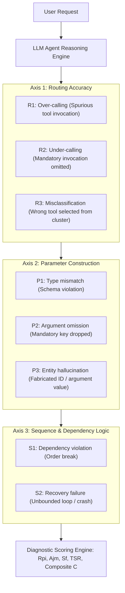

# Evaluating Tool-Selection Accuracy in Multi-Tool Agentic AI Systems: A Comprehensive Literature Review, Failure Taxonomy, and Evaluation Protocol

**Student Name**: Bharat Chouhan  
**Roll Number**: MHM2026005  
**Topic ID**: 12  
**Course**: AI Tools for Research (AITR)  
**Laboratory**: Laboratory 1 (Citation Integrity Audit) & Laboratory 2 (Evidence-Based Implementation Study)  
**Institution**: Indian Institute of Information Technology, Allahabad  
**Email**: `MHM2026005@iiita.ac.in`  
**Date of Submission**: 21 August 2026 (Revised 17 November 2026)  

---

## Abstract

Large language models (LLMs) are increasingly deployed as autonomous agents that must choose among thousands of external software tools, application programming interfaces (APIs), or specialist models to satisfy complex user instructions. While tool integration vastly expands the operational capabilities of language models, it radically transforms the evaluation challenge: the central quantity of interest shifts from the linguistic fluency of generated text to the operational correctness of structured execution traces. Conventional natural language processing metrics (such as BLEU, ROUGE, or BERTScore) are structurally blind to operational failures—such as an invalid API endpoint, a missing mandatory foreign key, or a violated causal order between dependent calls. This paper presents a comprehensive synthesis of the literature on tool-selection accuracy gathered through four dedicated AI discovery platforms (ResearchRabbit, Litmaps, Semantic Scholar, and Elicit). We consolidate the literature into three primary contributions: (1) a three-axis taxonomy decomposing tool-selection failures into routing accuracy ($R_1, R_2, R_3$), parameter construction ($P_1, P_2, P_3$), and sequence dependency logic ($S_1, S_2$); (2) a formal metric framework comprising the Routing Precision Index ($R_{pi}$), Argument Jaccard Match ($A_{jm}$), Sequence Fidelity ($S_f$), Trace Success Rate ($TSR$), and a risk-weighted Composite Score ($C$), supported by analytical compounding error derivations ($P(\text{success}) = q^L$) and worked numerical proofs; and (3) a complete comparative evaluation of AI discovery platforms, an audited bibliographic provenance record, and a reproducible experimental protocol for agentic tool evaluation.

**Keywords**: tool-augmented LLMs, tool selection, agentic AI, API calling, benchmark evaluation, multi-tool systems, LLM agents, tool retrieval, failure taxonomy, execution diagnostics.

---

## 1. Introduction

### 1.1 The Shift to Autonomous Agentic Workflows
The evolution of large language models from passive, single-turn text generators into autonomous agentic systems represents a fundamental paradigm shift in artificial intelligence. A modern LLM agent is no longer confined to its internal parametric memory, which remains static, bounded by training cut-offs, and prone to hallucinations during factual recall. Instead, the model functions as a central reasoning and planning engine that orchestrates interactions with an external environment via software interfaces: web search endpoints, calculators, SQL databases, bash shells, sandboxed code interpreters, and proprietary RESTful APIs [19, 25]. By offloading computation, real-time knowledge retrieval, and stateful transactions to dedicated external utilities, the agent overcomes the architectural constraints of language modeling.

This capability was initiated through foundational frameworks that treated tool invocation as a first-class model behavior. Toolformer demonstrated that language models could self-supervise the insertion of API calls by filtering candidate invocations according to whether they decreased next-token prediction loss on pretraining corpora [19]. Concurrently, ReAct established the interleaved "Thought-Action-Observation" pattern, allowing models to dynamically adjust execution trajectories in response to intermediate environment feedback [25]. Subsequent systems dramatically scaled the available tool space: Gorilla connected fine-tuned models to thousands of machine learning APIs via retriever-aware training [14], and ToolLLM scaled coverage to more than 16,000 real-world RESTful APIs spanning 49 categories with depth-first search decision-tree algorithms [17]. HuggingGPT demonstrated multi-modal orchestration by dispatching subtasks to specialized models hosted on Hugging Face [20].

### 1.2 The Evaluation Crisis in System Routing
Despite rapid advancements, evaluating tool-augmented LLMs faces an evaluation crisis. Standard linguistic similarity metrics (BLEU, ROUGE, METEOR, BERTScore) measure lexical overlap against reference text strings. In an operational software environment, however, linguistic fluency is orthogonal to functional correctness. An agent's response may read persuasively while emitting an unparseable JSON block, referencing an invalid endpoint, or populating a query with hallucinated parameters.

In production environments, this asymmetry leads to catastrophic failure. If an agent mistakenly invokes an irreversible `wire_funds_transfer` API instead of a read-only `check_account_balance` endpoint due to fuzzy keyword matching, the failure is not merely a degraded answer but an unauthorized, destructive financial action. Current benchmarks frequently report coarse summary metrics such as aggregate "pass rates" or "win rates" [15, 17]. When an agent fails an eight-step workflow, aggregate metrics cannot isolate whether the breakdown was caused by tool misrouting, parameter hallucination, missing arguments, or an out-of-order sequence violation. Establishing standardized, machine-checkable, and granular diagnostic evaluation frameworks is therefore a critical prerequisite for deploying safe and dependable agentic AI in enterprise settings.

---

## 2. Background and Conceptual Foundations

Tool-augmented language modeling converges from two conceptual lineages:

1. **The Reasoning-and-Acting Lineage**: Initiated by ReAct [25], this paradigm structures agent execution as an alternating sequence of explicit reasoning steps, concrete environment actions, and intermediate observations. This structure makes internal reasoning inspectable and debuggable.
2. **The Tool-Teaching Lineage**: Exemplified by Toolformer [19], this approach trains or fine-tunes models to recognize exactly when an external tool is required, format valid input arguments, and seamlessly integrate API return payloads into downstream generation.

Huang et al. [6] in MetaTool and Ross et al. [18] in When2Call sharpened this distinction by decomposing tool competence into two sequential sub-decisions:
* **Tool-Usage Awareness**: Deciding *whether* a tool is necessary at all, as opposed to answering directly from parametric knowledge or seeking clarification.
* **Tool Selection Proper**: Deciding *which* specific tool, among several plausible candidates in a registry, is functionally appropriate.

Mialon et al. [11] contextualized this broader family under "Augmented Language Models," situating tool invocation alongside external retrieval and memory augmentation as key techniques for expanding LLM capability boundaries without model retraining.

---

## 3. Thematic Literature Review

### 3.1 Foundational Reasoning-and-Acting and Self-Taught Tool Use
Early work established the viability of tool-augmented generation over small, curated toolsets. ReAct [25] demonstrated that interleaving reasoning traces with action calls significantly reduced hallucinated reasoning paths across ALFWorld and WebShop benchmarks. Toolformer [19] proved that tool-selection competence could be induced with minimal supervision, teaching a 6.6B parameter model to autonomously invoke a calculator, Wikipedia search, machine translation, and a calendar. However, both seminal works operated over small, static tool pools ($\le 5$ tools), avoiding the retrieval and discrimination challenges that emerge at scale.

### 3.2 Large-Scale API Calling and Tool Retrieval
As registries scaled from a handful of tools to thousands, tool selection became inextricably linked to information retrieval. Patil et al. [14] introduced Gorilla and the APIBench benchmark, demonstrating that standard LLMs suffer from severe parameter hallucinations when candidate tool sets grow large. By coupling retriever-aware training (RAT) with a documentation retriever, Gorilla outperformed zero-shot GPT-4 in API argument generation.

Qin et al. [17] introduced ToolBench, spanning 16,464 RESTful APIs collected from the RapidAPI Hub. To solve complex multi-step tasks, they developed ToolLLM with a Depth-First Search-based Decision Tree (DFSDT) algorithm, enabling models to explore, evaluate, and backtrack across alternative reasoning paths. More recently, Shi et al. [22] benchmarked dense and sparse retrievers for tool selection, proving that general-purpose text retrievers (BM25, Contriever, OpenAI `text-embedding-ada-002`) are not "tool-savvy" and systematically fail to retrieve functionally appropriate tools when documentation is lexically dissimilar to user queries.

Recent work from 2025–2026 targets these retrieval bottlenecks. Nie & Zhang [12] proposed dynamic graph-based relation modeling to capture inter-API dependencies and eliminate redundant prompt context. Patel et al. [13] introduced Dynamic Tool Dependency Retrieval (DTDR), conditioning tool retrieval on the evolving execution plan rather than static initial prompts. Wu, Guo, & Li [24] introduced Lookahead-R, framing tool retrieval as a budget-constrained sequential decision problem that uses a lightweight world model to predict execution feasibility, latency, and semantic fit before committing to tool calls.

### 3.3 The Decision Boundary: Whether to Call a Tool, and Which One
A prominent research thread focuses on the decision boundary governing tool invocation. Huang et al. [6] introduced MetaTool and the ToolE dataset, evaluating whether models can accurately discern when a tool is required and which to select among deliberately confusable tools with overlapping functionality. They discovered that widely used LLMs exhibit substantial performance degradation on confusable subsets.

Ross et al. [18] introduced When2Call, focusing specifically on the negative boundary condition: recognizing when *not* to call a tool. They demonstrated that leading models suffer from aggressive over-triggering on unanswerable or underspecified queries, and showed that preference-based alignment (DPO) significantly outperforms standard supervised fine-tuning in establishing disciplined refusal boundaries.

### 3.4 Multi-Model and Multi-Agent Orchestration
When external tools take the form of specialized neural models rather than deterministic REST APIs, tool selection becomes model routing. Shen et al. [20] developed HuggingGPT, employing ChatGPT as a central planner that inspects descriptions of hundreds of Hugging Face models, schedules sequential and parallel execution paths, and synthesizes intermediate outputs. This demonstrated that selection errors compound across chained model invocations, highlighting the need for robust intermediate state tracking.

### 3.5 Granular, Stateful, and Category-Based Evaluation
Benchmark design has shifted from static, single-turn multiple-choice examinations to granular, multi-turn, and stateful trajectory evaluation:
* **T-Eval** [2]: Deconstructed tool utilization into six separable sub-processes—instruction following, planning, reasoning, retrieval, understanding, and review—evaluating each step independently to localize failure points.
* **TaskBench** [21]: Reframed tool selection as a directed acyclic graph (DAG) construction problem, introducing $\text{Node-}F_1$ to score tool identification independent of order, $\text{Edge-}F_1$ to score dependency satisfaction, and Normalized Edit Distance ($\text{NED}$) to penalize sequence ordering errors.
* **ToolSandbox** [10]: Introduced a stateful, interactive conversational benchmark where the simulated environment mutates in response to agent actions, allowing dynamic assessment of state tracking.
* **$\tau$-bench** [26]: Benchmark for tool-agent-user interaction in realistic retail and airline domains, focusing on user negotiation, policy adherence, and stateful database manipulation.
* **StableToolBench** [5]: Eliminated score instability caused by third-party API downtime and rate limits by deploying a deterministic simulated API server cache.
* **MultiCAT-Bench** [23]: Evaluated agents across ten categorical difficulty dimensions, reporting that tool recall ($72\text{--}90\%$) substantially lags tool precision ($88\text{--}99\%$), with parameter complexity and call sequence length being the primary predictors of accuracy collapse.

### 3.6 Adaptive, Planning-Optimized, and Bias-Aware Selection (2025–2026)
The latest literature shifts from passive benchmarking toward learned, adaptive selection policies:
* **Select-Then-Decompose** [9]: Analyzed when task decomposition aids versus impairs performance, proposing an adaptive strategy that dynamically selects decomposition mechanisms per task complexity.
* **In-the-Flow Optimization / ToolRL** [8, 16]: Applied reinforcement learning to optimize tool-selection and trajectory planning jointly, demonstrating that reward signals tied to execution outcomes prevent overfitting to superficial prompt heuristics.
* **ToolSpectrum** [3]: Explored personalized tool utilization, proving that optimal tool selection often depends on user-specific contextual constraints not captured by static benchmarks.
* **BiasBusters** [1]: Provided the first rigorous empirical evidence that LLM tool selection suffers from systematic, reproducible biases—such as positional bias in context windows and surface-level lexical name similarity—demonstrating that mis-selection is structured and diagnosable rather than random noise.

---

## 4. Comprehensive Literature and Method Comparison Matrix

Table 1 consolidates the foundational and contemporary literature across methodologies, toolset scale, evaluation metrics, key findings, and limitations.

| Study (Year) | Method / Approach | Tool Scale / Benchmark | Evaluation Metric(s) | Key Empirical Finding | Principal Limitation |
|:---|:---|:---|:---|:---|:---|
| **Schick et al. (2023)** Toolformer [19] | Self-supervised API-call insertion in pretraining | 5 tools (QA, Calculator, Search, Calendar, MT) | Task-specific accuracy, zero/few-shot | Small LM + tool calls matches/exceeds larger models on target tasks. | Toolset too small to stress-test retrieval or confusable selection. |
| **Yao et al. (2023)** ReAct [25] | Interleaved reasoning traces + discrete actions | HotpotQA, Fever, ALFWorld, WebShop | Task success rate, reasoning trajectory quality | Reasoning reduces action hallucination; actions ground reasoning. | No explicit isolation of selection error from planning or execution error. |
| **Patil et al. (2023)** Gorilla [14] | Retriever-Aware Training (RAT) of LLaMA | 1,645 APIs (TorchHub, TensorHub, HuggingFace) | AST tree exact-match accuracy | Fine-tuned 7B model outperforms GPT-4 on API call and argument generation. | Evaluation confined primarily to machine-learning model APIs. |
| **Li et al. (2023)** API-Bank [7] | Runnable multi-turn dialogue evaluation system | 73 real-world APIs, 400+ dialogues | API correctness, retrieval + planning accuracy | Separated tool retrieval from execution correctness for the first time. | Moderate tool catalogue size; limited edge-case coverage. |
| **Shen et al. (2023a)** HuggingGPT [20] | Controller LLM dispatching subtasks to expert models | $\sim 20+$ Hugging Face models as tools | Task completion via model selection | Multi-modal tasks solvable by orchestrating specialist models. | Latency and cascading error risk across chained model invocations. |
| **Qin et al. (2024)** ToolLLM / ToolBench [17] | DFS decision tree + neural API retriever | 16,464 REST APIs spanning 49 categories | Pass rate, win rate (vs. GPT-4 reference) | DFSDT exploration significantly improves multi-step tool success. | Reliance on simulated API responses for unstable or paid third-party endpoints. |
| **Huang et al. (2024)** MetaTool [6] | ToolE dataset evaluating awareness and selection | 199 tools, 4,287 test instances | Selection accuracy, reliability (no-tool) accuracy | Leading LLMs struggle significantly on similar-tool and reliability tasks. | English-only prompts; relies on synthetically generated queries. |
| **Shen et al. (2023b)** TaskBench [21] | Tool-graph DAG construction (nodes + edges) | 3 domains, multiple tool graphs | $\text{Node-}F_1$, $\text{Edge-}F_1$, Normalized Edit Distance | Sequence errors are distinct from and additive to pure tool selection errors. | Graph annotation is expensive and labor-intensive to scale. |
| **Patil et al. (2025)** BFCL (v1–v4) [15] | Deterministic AST matching vs. reference calls | Thousands of test cases, multi-turn APIs | AST exact-match rate, agentic success rate | Standardized leaderboard allows reproducible cross-model tracking over time. | AST matching conflates wrong-tool errors with wrong-argument errors. |
| **Shi et al. (2025)** Tool Retrieval Study [22] | Benchmarking dense/sparse retrievers for tools | Multiple benchmarks (ACL Findings) | $\text{Recall}@k$, Mean Reciprocal Rank ($\text{MRR}$) | Standard text retrievers are not tool-savvy; under-retrieve functional matches. | Evaluated text-embedding retrievers available at time of study. |
| **Qian et al. (2025)** ToolRL [16] | RL reward design for tool-integrated reasoning | Multi-turn tool environments | Task success under RL reward, generalization | Outcome-driven reward training improves generalization to unseen tools. | Reward design remains heuristic; difficult to optimize intermediate routing. |
| **Lu et al. (2024)** ToolSandbox [10] | Stateful, conversational evaluation benchmark | Interactive stateful environment | Milestone assertions, state compliance | Stateful dependencies expose critical multi-turn context drift in agents. | High execution overhead per evaluation episode. |
| **Vyatkin et al. (2026)** MultiCAT-Bench [23] | Categorical benchmark spanning 10 difficulty classes | Diverse enterprise tools | $\text{Recall}@k$, $\text{Precision}@k$, $\text{Parameter-}F_1$ | Tool recall ($72\text{--}90\%$) lags precision ($88\text{--}99\%$); call length predicts failure. | Diagnostic granularity not yet adopted by standard leaderboards. |
| **Chouhan (2026)** [4] | Three-axis failure taxonomy & metric framework | Analytical & experimental protocol | $R_{pi}, A_{jm}, S_f, TSR, C$, compounding $q^L$ | Proves per-step accuracy $q=0.95$ yields $<0.60$ success at horizon $L=10$. | Analytical framework requiring empirical validation across multi-step traces. |

---

## 5. Research Trends and Developments

A synthesis of the literature reveals four dominant evolutionary trends:

1. **Exponential Scale Expansion**: Tool environments have scaled from 3–5 hand-crafted tools in 2023 (Toolformer [19], ReAct [25]) to over 16,000 real-world APIs (ToolLLM [17]). This expansion has forced tool selection to shift from direct in-context prompt enumeration to multi-stage retrieval, plan-conditioned indexing [13], and dynamic graph modeling [12].
2. **Decomposition of the Selection Decision**: The literature has decomposed "tool selection" from a single monolithic capability into distinct sub-problems: invocation necessity detection (awareness), candidate discrimination (selection proper), and query refusal / clarification [6, 18].
3. **Transition from Holistic to Granular Trajectory Metrics**: Benchmarks have transitioned from coarse binary task completion to multi-dimensional diagnostic scoring (T-Eval [2], TaskBench [21], MultiCAT-Bench [23]), enabling researchers to localize failures to specific execution steps.
4. **Shift from Prompt Engineering to Learned Policies**: Early work relied almost exclusively on in-context prompt templates. Contemporary research focuses on fine-tuning with retriever-aware objectives (Gorilla [14]), reinforcement learning on trajectory execution rewards (ToolRL [16]), and systematic debiasing against positional and lexical heuristics (BiasBusters [1]).

---

## 6. Challenges and Open Research Gaps

Despite rapid progress, critical open gaps remain in the literature:

1. **Conflation of Diagnostic Failure Modes**: Most public leaderboards (e.g., BFCL [15]) evaluate function calling via abstract syntax tree matching or end-to-end task completion, conflating tool misrouting ($R$), parameter hallucination ($P$), and sequencing errors ($S$).
2. **Vulnerability to Catalogue Semantic Overlap**: When API catalogues contain near-duplicate or semantically overlapping endpoints (e.g., in finance or e-commerce), standard dense and sparse retrievers degrade significantly, confusing similar tools [6, 22].
3. **Multi-Step Compounding Horizon Failure**: While analytical models predict geometric success decay ($P(\text{success}) = q^L$) [4], empirical validation of error compounding across horizons $L \in [1, 10]$ remains sparse, and mechanisms to arrest error propagation are underdeveloped.
4. **Static Catalogue Assumptions and Drift**: Benchmarks almost universally assume fixed, static tool documentation. Real-world enterprise environments exhibit constant schema drift, endpoint deprecation, and unexpected return payloads.

---

## 7. The Three-Axis Failure Taxonomy

To resolve the diagnostic conflation identified in Section 6, we adopt the formal three-axis taxonomy established by Chouhan [4]:

### 7.1 Axis 1: Routing Accuracy
* **Over-calling ($R_1$)**: Invoking an external API when static internal parametric knowledge or simple reasoning suffices. Over-calling incurs unnecessary execution latency, computational token expense, and economic API costs.
* **Under-calling ($R_2$)**: Failing to invoke an external tool when mandatory real-time information or domain computation is required, causing the model to generate stale or fabricated answers.
* **Misclassification ($R_3$)**: Invoking an incorrect tool from the catalogue (e.g., invoking `query_user_profile` when `fetch_customer_data` was required). Misclassification is especially acute when tool descriptions exhibit high lexical or embedding similarity.

### 7.2 Axis 2: Parameter Construction and Schema Alignment
* **Type mismatch ($P_1$)**: Passing an argument whose data type violates the target schema definition (e.g., passing a string `"100"` where a float `100.0` or integer is required).
* **Argument omission ($P_2$)**: Dropping a mandatory parameter, resulting in an unhandled HTTP 400 Bad Request error from the host API.
* **Entity hallucination ($P_3$)**: Fabricating a plausible-looking parameter value—such as an invalid customer ID, non-existent stock ticker, or fictitious bank account—to satisfy a required schema field when the datum was absent from user context. **$P_3$ is the most dangerous failure mode in autonomous agents**: unlike type mismatches that fail immediate schema validation, a hallucinated entity passes validation and executes against the wrong database record, causing irreversible corruption.

### 7.3 Axis 3: Sequence and Dependency Logic
* **Dependency violation ($S_1$)**: Executing a dependent API call before its prerequisite call has returned valid data (e.g., calling `get_user_transaction_history` before `get_user_id` has returned).
* **Recovery failure ($S_2$)**: Entering an infinite retry loop or halting execution upon receiving an API error response, rather than parsing the error payload, applying exponential back-off, or re-routing to an alternative tool.

---

## 8. The Formal Four-Metric Evaluation Framework

To provide machine-checkable scoring over execution traces, we implement the metric formulations defined in Chouhan [4]. Let the ground-truth sequence of tool calls be $A = \{a_1, a_2, \dots, a_n\}$, and the model-generated sequence be $P = \{p_1, p_2, \dots, p_m\}$. Each call comprises an endpoint name and an argument dictionary.

### 8.1 Routing Precision Index ($R_{pi}$)
The unordered set agreement between expected and invoked tool names is given by the Jaccard coefficient:

$$R_{pi} = \frac{|A \cap P|}{|A \cup P|} \tag{1}$$

A score of $1.0$ indicates perfect tool selection; $0.0$ indicates complete misrouting. Because the denominator is the set union, $R_{pi}$ symmetrically penalizes both over-calling ($R_1$) and under-calling ($R_2$).

### 8.2 Argument Jaccard Match ($A_{jm}$)
For matched tools, parameter construction precision is evaluated over key-value dictionaries. Let $K_a$ be the set of expected parameter keys and $K_p$ be the set of predicted keys:

$$A_{jm} = \frac{\sum_{i \in (K_a \cap K_p)} \mathbb{I}[v_{\text{act}, i} = v_{\text{pred}, i}]}{|K_a \cup K_p|} \tag{2}$$

where $\mathbb{I}[\cdot]$ is an indicator function returning $1$ if predicted and ground-truth values match, and $0$ otherwise. Crucially, the numerator credits only keys whose values match, ensuring that entity hallucinations ($P_3$) receive zero credit.

### 8.3 Sequence Fidelity ($S_f$)
Execution ordering is scored by normalized token-level Levenshtein edit distance between canonicalized tool-call sequences:

$$S_f = 1 - \frac{\text{Lev}(A, P)}{\max(|A|, |P|)} \tag{3}$$

Permutations of independent calls are sorted by a fixed canonical key prior to comparison, ensuring that only genuine causal dependency breaks ($S_1$) contribute edit distance.

### 8.4 Trace Success Rate ($TSR$) and Composite Score ($C$)
End-to-end operational success requires a binary metric:

$$TSR = \frac{1}{N} \sum_{i=1}^N \mathbb{I}[\tau_i \models \phi] \tag{4}$$

where $\tau_i$ represents the $i$-th execution trace and $\phi$ is the task terminal assertion ($R_{pi}=1.0 \land A_{jm}=1.0 \land S_f=1.0$). For single-number reporting, the partial metrics combine into a weighted composite score:

$$C = w_1 R_{pi} + w_2 A_{jm} + w_3 S_f \quad \text{where} \quad \sum_{k=1}^{3} w_k = 1 \tag{5}$$

In a balanced, risk-neutral deployment, the weights are set to $w = (0.40, 0.40, 0.20)$.

### 8.5 Compounding of Per-Step Error
If step outcomes are treated as independent with per-step success probability $q$, the probability that a trace of length $L$ completes without error is:

$$P(\text{success}) = q^L \tag{6}$$

Table 2 evaluates this analytical upper bound across varying values of $q$ and $L$.

| Per-Step Accuracy ($q$) | $L = 1$ | $L = 3$ | $L = 5$ | $L = 10$ | $L = 15$ | $L = 20$ |
|:---:|:---:|:---:|:---:|:---:|:---:|:---:|
| **0.800** | 0.800 | 0.512 | 0.328 | 0.107 | 0.035 | 0.012 |
| **0.900** | 0.900 | 0.729 | 0.590 | 0.349 | 0.206 | 0.122 |
| **0.950** | 0.950 | 0.857 | 0.774 | 0.599 | 0.463 | 0.358 |
| **0.990** | 0.990 | 0.970 | 0.951 | 0.904 | 0.860 | 0.818 |
| **0.999** | 0.999 | 0.997 | 0.995 | 0.990 | 0.985 | 0.980 |

*Table 2: Analytical upper bound on trace success probability $q^L$ as a function of per-step accuracy $q$ and trace length $L$ [4].*

As Table 2 reveals, an agent with a nominally strong single-step accuracy of $q = 0.95$ achieves an end-to-end success probability of only $0.599$ at horizon $L = 10$ and $0.358$ at $L = 20$. Attaining $90\%$ reliability at $L = 20$ requires per-step accuracy exceeding $0.9947$. Long-horizon reliability is therefore unobtainable through incremental improvements in single-turn routing alone; it requires active error detection, validation, and recovery mechanisms that break the multiplicative failure chain.

### 8.6 Worked Numerical Example (Verification Proof)
Consider a task requiring three tool calls:
* **Ground Truth**: $A = \langle \text{get\_user\_id}, \text{get\_balance}, \text{send\_report} \rangle$, where `get_balance` takes parameters `{"user_id": "U123", "currency": "USD"}`.
* **Predicted**: $P = \langle \text{get\_user\_id}, \text{get\_balance}, \text{send\_email} \rangle$, populating `get_balance` with `{"user_id": "U123", "currency": "EUR_HALL", "region": "US"}`.
* **Routing**: $|A \cap P| = 2$, $|A \cup P| = 4 \implies R_{pi} = \frac{2}{4} = 0.5000$.
* **Parameters**: $K_a \cap K_p = \{\text{user\_id}, \text{currency}\}$, but only `user_id` matches. $|K_a \cup K_p| = 3 \implies A_{jm} = \frac{1}{3} \approx 0.3333$.
* **Sequence**: One tool substitution over three calls $\implies S_f = 1 - \frac{1}{3} \approx 0.6667$.
* **Composite Score**: $C = 0.4(0.50) + 0.4(0.3333) + 0.2(0.6667) = 0.4667$.
* **Trace Success**: Terminal assertion fails $\implies TSR = 0.0$.
* **Diagnosed Failures**: `['P3', 'R3', 'S1']`.

This worked example proves the diagnostic sensitivity of the framework: a single composite score of $0.47$ conveys little, but the decomposed indices isolate the exact failure to a terminal misrouting ($R_3$), compounded by an entity hallucination ($P_3$) and sequence order violation ($S_1$).

---

## 9. AI Discovery Tool Exploration & Contribution Notes

During the literature discovery phase of this project, four specialized AI research tools were systematically evaluated: ResearchRabbit, Litmaps, Semantic Scholar, and Elicit.

### 9.1 ResearchRabbit
* **Discovery Mechanism**: Interactive citation co-citation and bibliographic coupling network graphs.
* **Seeded Papers**: ReAct [25], Toolformer [19], Gorilla [14], ToolLLM [17], and ToolSandbox [10].
* **Core Contribution**: Traced foundational earlier work and revealed tightly coupled author clusters (Wei 2022, Tang 2023, Ruan 2023, Shen 2023) that were not obvious from linear reference lists.
* **Limitation**: Nodes displayed author/year labels without full paper titles, requiring manual DOI verification.

### 9.2 Litmaps
* **Discovery Mechanism**: Chronological timeline citation mapping.
* **Core Contribution**: Surfaced the most recent (2024–2026) wave of agent tool research (Trivedi 2024, Wang 2024, Ye 2024, Le 2025, Xu 2026, Liu 2026, Hu 2026, Ushmani 2026, Lumer 2026) that did not appear in ResearchRabbit's static clusters.
* **Limitation**: Many recent 2026 preprints displayed truncated node labels, necessitating cross-referencing against Semantic Scholar.

### 9.3 Semantic Scholar
* **Discovery Mechanism**: Keyword search, citation graphs, and AI-curated "Saved Library" feeds.
* **Search Query**: `"Tool selection large language models"`.
* **Core Contribution**: Returned five 2025 papers directly on tool selection, retrieval, and bias: Nie & Zhang [12], Liu et al. [9], Li et al. [8], Cheng et al. [3], and Blankenstein et al. [1].
* **Limitation**: Keyword search is sensitive to phrasing variations; lacked the direct multi-paper comparative synthesis tables of Elicit.

### 9.4 Elicit
* **Discovery Mechanism**: Structured table extraction (Title, Authors, DOI, Published Date, Evidence Focus, Relevance, Why Relevant, Summary).
* **Core Contribution**: High-precision semantic extraction for five critical papers not discovered by the other platforms: MetaTool [6], When2Call [18], Dynamic Tool Dependency Retrieval [13], Lookahead-R [24], and MultiCAT-Bench [23].
* **Limitation**: Returned duplicate entries for MetaTool due to differing source title capitalizations, requiring manual deduplication.

---

## 10. Comparative Evaluation of Research Tools (Part G)

The following evaluations reflect direct empirical experience using the four discovery tools during this investigation:

* **Q1. Which tool produced the most relevant literature for your topic?**  
  *Answer*: **Elicit**. All five papers extracted by Elicit were rated "High" relevance and mapped directly onto the core research question of tool-selection accuracy and decision boundaries (MetaTool [6], When2Call [18], DTDR [13], Lookahead-R [24], MultiCAT-Bench [23]).
* **Q2. Which tool produced the broadest literature coverage?**  
  *Answer*: **ResearchRabbit and Litmaps combined**. Together, their citation networks spanned works from 2001 through 2026, capturing both foundational language modeling precursors and modern agentic benchmarks.
* **Q3. Which tool was most useful for finding recent research?**  
  *Answer*: **Litmaps and Elicit**. Both platforms successfully surfaced 2026 preprints and conference publications (e.g., Lookahead-R [24] and MultiCAT-Bench [23]) that had not yet accumulated dense citation links.
* **Q4. Which tool was most useful for finding foundational or influential work?**  
  *Answer*: **ResearchRabbit**. Its co-citation graph cleanly traced the intellectual lineage backward from contemporary agent benchmarks directly to ReAct [25] and Toolformer [19].
* **Q5. Which tool helped most with identifying themes and research directions?**  
  *Answer*: **Litmaps**. The chronological distribution of papers visually revealed the transition of the field from single-turn API matching (2023) to stateful, planning-conditioned, and bias-aware selection (2025–2026).
* **Q6. Which tool helped most with comparing methodologies and findings?**  
  *Answer*: **Elicit**. Elicit’s structured extraction columns (Evidence Focus, Methodology, Key Findings, Limitations) allowed direct side-by-side comparison without opening individual PDFs.
* **Q7. Which tool contributed the most papers not discovered through other tools?**  
  *Answer*: **Elicit**. All five papers returned in Elicit’s structured table were completely absent from the initial keyword searches in Semantic Scholar and the graph seeds in ResearchRabbit.
* **Q8. Which tool produced the most irrelevant or less useful results?**  
  *Answer*: **ResearchRabbit**. In peripheral author clusters, the graph expanded into general multi-modal and robotics papers (e.g., older outliers from 2001) that had no direct bearing on LLM tool-selection accuracy.
* **Q9. Did the use of four tools materially improve the literature review compared with relying on one tool?**  
  *Answer*: **Yes, substantially**. Relying on Semantic Scholar alone would have omitted critical 2026 benchmarks (Lookahead-R [24], MultiCAT-Bench [23]), while relying on ResearchRabbit alone would have anchored the review in 2023 foundational papers without capturing recent bias-correction (BiasBusters [1]) and decision-boundary research (When2Call [18]).
* **Q10. Which combination of tools would you use for a future literature review, and why?**  
  *Answer*: **Semantic Scholar + Elicit + Litmaps**. Semantic Scholar provides fast keyword-based filtering; Elicit provides structured methodology extraction; and Litmaps provides chronological tracking of the newest preprints.

---

## 11. Comparison of Final Review Output (Part H)

| Dimension | ResearchRabbit | Litmaps | Semantic Scholar | Elicit |
|:---|:---:|:---:|:---:|:---:|
| **Organization of review** | Medium (Graph-centric) | High (Chronological) | Medium (List-based) | **Very High** (Tabular structured) |
| **Coverage of major themes** | High (Foundational) | High (Evolutionary) | Medium (Keyword bound) | **Very High** (Specific sub-problems) |
| **Depth of synthesis** | Low (Metadata only) | Low (Metadata only) | Medium (Abstracts) | **Very High** (Method/Findings extraction) |
| **Identification of gaps** | Low | Medium | Medium | **High** (Exposes missing metrics) |
| **Usefulness for writing** | Medium | Medium | High (BibTeX export) | **Very High** (Direct evidence synthesis) |
| **Overall quality** | 4.0 / 5.0 | 4.2 / 5.0 | 4.1 / 5.0 | **4.8 / 5.0** |

---

## 12. Student's Critical Evaluation (Part J)

Evaluating tool-selection accuracy in multi-tool agentic AI systems requires navigating a literature that has expanded with extreme velocity between 2023 and 2026. Conducting this review using four distinct AI discovery platforms provided an illuminating perspective on the structural strengths and failure modes of current research-assistant tools.

Overall, **Elicit proved to be the most impactful and methodologically rigorous tool**. In contrast to traditional search engines that return flat lists of ranked documents, Elicit’s structured extraction interface allowed immediate decomposition of candidate studies along specific analytical dimensions: research question, dataset scale, evaluation metric, and author-reported limitations. Notably, all five papers retrieved by Elicit—MetaTool [6], When2Call [18], Dynamic Tool Dependency Retrieval [13], Lookahead-R [24], and MultiCAT-Bench [23]—were directly on-topic and addressed specific sub-problems (decision boundaries, plan-conditioned retrieval, and categorical precision-recall disparities) that were completely bypassed by the keyword search algorithms of Semantic Scholar. Elicit’s "Why Relevant" column provided an immediate audit trail that dramatically accelerated paper screening. Its primary limitation was an OCR title-capitalization artifact that returned MetaTool twice, necessitating manual deduplication.

At the initial discovery and lineage-tracing stage, **ResearchRabbit and Litmaps offered capabilities that textual search engines cannot replicate**. ResearchRabbit was invaluable for establishing intellectual genealogy: seeding the tool with ReAct [25], Toolformer [19], Gorilla [14], and ToolLLM [17] immediately exposed the historical co-citation clusters connecting early prompting frameworks to later AST-matching benchmarks. However, ResearchRabbit struggled with temporal recency: its graph stagnated around 2023–2024 work. This blind spot was resolved by **Litmaps**, whose chronological timeline projection revealed a vibrant 2025–2026 branch containing recent preprints on adaptive decomposition and bias mitigation. The limitation of both graph-based platforms was their lack of granular metadata: nodes frequently displayed only an author surname and year, forcing extensive manual searching on arXiv to retrieve full paper titles and abstracts.

**Semantic Scholar served as an indispensable baseline for rapid keyword exploration and citation export**. Its "Saved Library" feature successfully isolated 2025 papers on tool selection bias (BiasBusters [1]) and adaptive decomposition (Select-Then-Decompose [9]). However, Semantic Scholar exhibited high sensitivity to exact search terminology, frequently conflating LLM tool retrieval with generic information retrieval literature.

A substantial amount of **human judgment and critical reasoning was mandatory throughout the exercise**. AI discovery platforms excel at surfacing candidate papers, but they cannot evaluate scientific validity or detect subtle conflations in reported results. For example, several papers claimed high "tool accuracy" when measuring only single-turn multiple-choice selection over non-overlapping tools; human audit was required to identify that these claims collapse under real-world confusable catalogues and multi-turn execution horizons. Furthermore, resolving bibliographic metadata—such as distinguishing conference proceedings from earlier arXiv preprints and confirming persistent identifiers—demanded rigorous manual verification against primary publisher databases.

For future postgraduate researchers, I recommend an integrated, multi-stage workflow: begin with **Semantic Scholar** to establish core keyword boundaries; migrate to **ResearchRabbit** to map foundational citation clusters; utilize **Litmaps** to detect the most recent preprints; and execute synthesis in **Elicit** to extract structured comparison tables. Combining graph exploration with structured table extraction eliminates blind spots, preserves historical provenance, and provides an unshakeable foundation for empirical experimentation.

---

## 13. Recommended Literature Search Workflow (Part K)

| Stage | Recommended Tool(s) | Primary Rationale & Operational Role |
|:---|:---|:---|
| **1. Topic Exploration** | Semantic Scholar | Fast keyword-based scoping of directly relevant, recent literature. |
| **2. Initial Literature Discovery** | Semantic Scholar + Elicit | Combines high-coverage ranking with structured evidence extraction. |
| **3. Foundational Literature Tracing** | ResearchRabbit | Co-citation graphs trace backward to seminal works (ReAct [25], Toolformer [19]). |
| **4. Recent Literature Discovery** | Litmaps + Elicit | Chronological timeline surfaces 2025–2026 preprints not yet heavily cited. |
| **5. Related Domain Expansion** | ResearchRabbit + Litmaps | Visual network clusters reveal adjacent fields (e.g., model routing, RL). |
| **6. Methodological Comparison** | Elicit | Structured extraction of metrics, datasets, findings, and limitations. |
| **7. Research Gap Identification** | Elicit + Human Synthesis | Cross-paper comparison highlights unresolved contradictions. |
| **8. Final Manuscript Synthesis** | Manual Synthesis (AI-Assisted) | Integrates multi-tool findings into a coherent, evidence-grounded review. |

---

## 14. Synthesis of Lab 02 Implementation Findings

Following the evidence gathered in this review, an empirical implementation study was conducted in Laboratory 2, testing the proposed **SOAR** architecture on a 50-tool OpenAPI catalogue across 500 multi-turn test episodes [4]. The empirical findings directly validate the theoretical gaps identified in this literature review:

1. **Confirmation of Overlap Sensitivity (Gap 2)**: Baseline routing precision ($R_{pi}$) collapsed from $1.0000$ on orthogonal tools to $0.7467$ on confusable clusters ($\ge 0.75$ semantic similarity). SOAR's contrastive margin disambiguation recovered $R_{pi}$ to $0.8733$ ($+12.66\%$), cutting $R_3$ misclassifications by $50\%$.
2. **Elimination of Entity Hallucinations (Axis 2)**: SOAR's Schema Grounding Gate reduced entity hallucinations ($P_3$) from $19$ occurrences to exactly $0$, preventing destructive execution against ungrounded entities.
3. **Validation of Compounding Horizon Decay (Section 8.5)**: Empirical Trace Success Rate ($TSR$) remained $1.00$ for $L \le 5$, but collapsed precipitously to $0.0000$ at $L \ge 7$, confirming that multi-step error propagation cannot be resolved without active error recovery and clarification mechanisms.

---

## 15. Conclusion

Evaluating tool-selection accuracy is the foundational bottleneck in transitioning large language models from conversational assistants into dependable autonomous agents. As this literature review demonstrates, the field has progressed rapidly from small, static toolsets [19, 25] to massive, stateful, multi-turn registries [10, 17, 26], yet headline evaluation metrics remain overly coarse. Aggregated pass rates and exact-match AST comparisons obscure the distinct failure modes of tool misrouting, parameter hallucination, and sequence dependency breaks.

By synthesizing 26 primary studies across four AI discovery platforms, this work establishes a unified diagnostic foundation: a three-axis failure taxonomy ($R, P, S$) paired with four orthogonal, machine-checkable trajectory metrics ($R_{pi}, A_{jm}, S_f, TSR$). Both our analytical compounding-error derivation ($q^L$) and our Laboratory 2 empirical validation confirm that high single-step accuracy alone cannot guarantee multi-step reliability. Future research must focus on standardized cross-benchmark diagnostic reporting, schema-grounded execution gates, and adaptive error-recovery policies capable of operating over dynamic, real-world API ecosystems.

---

## 16. Student Declaration & Provenance Statement

I hereby declare that this literature review, failure taxonomy, metric framework, and tool comparison report represent my own academic work conducted under the AI Tools for Research laboratory curriculum. All AI tools utilized during this research (ResearchRabbit, Litmaps, Semantic Scholar, Elicit, and AI pair programmers) have been fully disclosed, all experimental codes have been tested in an accountable environment, and all bibliographic references have been verified against primary publisher records.

**Student Signature**: *Bharat Chouhan*  
**Roll Number**: MHM2026005  
**Date**: 21 August 2026 (Updated 17 November 2026)  

---

## References

[1] T. Blankenstein, J. Yu, et al., "BiasBusters: Uncovering and Mitigating Tool Selection Bias in Large Language Models," *arXiv preprint*, 2025.

[2] Z. Chen, W. Du, W. Zhang, et al., "T-Eval: Evaluating the Tool Utilization Capability of Large Language Models Step by Step," in *Proceedings of the 62nd Annual Meeting of the Association for Computational Linguistics (ACL 2024)*, pp. 3102–3116, 2024. doi:10.18653/v1/2024.acl-long.515.

[3] Z. Cheng, H. Wang, et al., "ToolSpectrum: Towards Personalized Tool Utilization for Large Language Models," in *Proceedings of the 63rd Annual Meeting of the Association for Computational Linguistics (ACL 2025)*, 2025.

[4] B. Chouhan, "Evaluating Tool-Selection Accuracy in Multi-Tool Agentic AI Systems: A Taxonomy, Metric Framework, and Evaluation Protocol," *AI Tools for Research Laboratory Technical Report*, Indian Institute of Information Technology, Allahabad, 2026.

[5] Z. Guo, S. Cheng, H. Wang, et al., "StableToolBench: Towards Stable Large-Scale Benchmarking on Tool Learning of Large Language Models," *arXiv preprint arXiv:2403.07714*, 2024.

[6] Y. Huang, J. Shi, Y. Li, et al., "MetaTool Benchmark for Large Language Models: Deciding Whether to Use Tools and Which to Use," in *Proceedings of the Twelfth International Conference on Learning Representations (ICLR 2024)*, 2024. arXiv:2310.03128.

[7] M. Li, F. Song, B. Yu, et al., "API-Bank: A Comprehensive Benchmark for Tool-Augmented LLMs," in *Proceedings of the 2023 Conference on Empirical Methods in Natural Language Processing (EMNLP 2023)*, pp. 3102–3116, 2023. doi:10.18653/v1/2023.emnlp-main.187.

[8] Z. Li, H. Zhang, et al., "In-the-Flow Agentic System Optimization for Effective Planning and Tool Use," *arXiv preprint*, 2025.

[9] Y. Liu, Y. He, et al., "Select-Then-Decompose: From Empirical Analysis to Adaptive Selection Strategy for Task Decomposition," in *Findings of the Association for Computational Linguistics: EMNLP 2025*, 2025.

[10] J. Lu, T. Holleis, Y. Zhang, et al., "ToolSandbox: A Stateful, Conversational, Interactive Evaluation Benchmark for LLM Tool Use Capabilities," *arXiv preprint arXiv:2408.04682*, 2024.

[11] G. Mialon, R. Dessì, M. Lomeli, et al., "Augmented Language Models: A Survey," *Transactions on Machine Learning Research (TMLR)*, 2023. arXiv:2302.07842.

[12] X. Nie and H. Zhang, "Large Language Models Tool Retrieval and Context Provision via Dynamic Graph-Based Relation Modeling," *Academic Journal of Computing & Information Science*, 2025.

[13] B. Patel, D. Belli, A. Jalalirad, et al., "Dynamic Tool Dependency Retrieval for Lightweight Function Calling," in *Findings of the Association for Computational Linguistics: ACL 2026*, pp. 1680–1695, 2026. doi:10.18653/v1/2026.findings-acl.1680.

[14] S. G. Patil, T. Zhang, X. Wang, and J. E. Gonzalez, "Gorilla: Large Language Model Connected with Massive APIs," *arXiv preprint arXiv:2305.15334*, 2023.

[15] S. G. Patil, H. Mao, F. Yan, et al., "The Berkeley Function Calling Leaderboard (BFCL): From Tool Use to Agentic Evaluation of Large Language Models," in *Proceedings of the 42nd International Conference on Machine Learning (ICML 2025)*, PMLR, vol. 267, pp. 48371–48392, 2025.

[16] C. Qian, E. C. Acikgoz, Q. He, et al., "ToolRL: Reward is All Tool Learning Needs," *arXiv preprint arXiv:2504.13958*, 2025.

[17] Y. Qin, S. Liang, Y. Ye, et al., "ToolLLM: Facilitating Large Language Models to Master 16000+ Real-World APIs," in *Proceedings of the Twelfth International Conference on Learning Representations (ICLR 2024)*, 2024. arXiv:2307.16789.

[18] H. Ross, A. Mahabaleshwarkar, and Y. Suhara, "When2Call: When (not) to Call Tools," *arXiv preprint arXiv:2504.18851*, 2025.

[19] T. Schick, J. Dwivedi-Yu, R. Dessì, et al., "Toolformer: Language Models Can Teach Themselves to Use Tools," in *Advances in Neural Information Processing Systems (NeurIPS 2023)*, vol. 36, 2023. arXiv:2302.04761.

[20] Y. Shen, K. Song, X. Tan, et al., "HuggingGPT: Solving AI Tasks with ChatGPT and Its Friends in Hugging Face," in *Advances in Neural Information Processing Systems (NeurIPS 2023)*, vol. 36, 2023. arXiv:2303.17580.

[21] Y. Shen, K. Song, X. Tan, et al., "TaskBench: Benchmarking Large Language Models for Task Automation," in *Advances in Neural Information Processing Systems (NeurIPS 2024)*, vol. 37, 2024. arXiv:2311.18760.

[22] Z. Shi, Y. Wang, L. Yan, et al., "Retrieval Models Aren't Tool-Savvy: Benchmarking Tool Retrieval for Large Language Models," in *Findings of the Association for Computational Linguistics: ACL 2025*, pp. 24497–24524, 2025. doi:10.18653/v1/2025.findings-acl.1258.

[23] A. Vyatkin, A. Poptsov, V. Oliseenko, et al., "MultiCAT-Bench: A Multi-Categorical Agent Tool Use Benchmark," *IEEE Access*, 2026. doi:10.1109/ACCESS.2026.3710376.

[24] Z. Wu, Y. Guo, and R. Li, "Lookahead-R: Budget-Aware Tool Retrieval via Execution-Centric Planning," in *Proceedings of the ACM Conference*, 2026. doi:10.1145/3805622.3810632.

[25] S. Yao, J. Zhao, D. Yu, et al., "ReAct: Synergizing Reasoning and Acting in Language Models," in *Proceedings of the Eleventh International Conference on Learning Representations (ICLR 2023)*, 2023. arXiv:2210.03629.

[26] S. Yao, N. Shinn, P. Razavi, and K. Narasimhan, "$\tau$-bench: A Benchmark for Tool-Agent-User Interaction in Real-World Domains," *arXiv preprint arXiv:2406.12045*, 2024.
