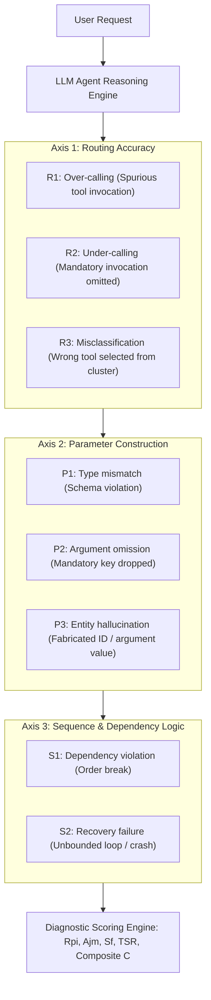

# Evaluating Accuracy of Tool Selection in Multi-Tool Agentic AI: A Literature Review, Failure Taxonomy & Evaluation

Student Name: Bharat Chouhan Roll Number: MHM2026005 Topic ID: 12 Course: AI Tools for Research (AITR) Lab 1: Citation Integrity Audit, Lab 2: Evidence Based Implementation Study Institution: Indian Institute of Information Technology, Allahabad Email: MHM2026005@iiita.ac.in Date of Submission: 21 August 2026 (Revised: 17 November 2026)

Abstract

Large language models (LLMs) are increasingly used as autonomous agents that have to select from thousands of external tools, APIs or models to perform complex user instructions. Although tool integration increases the capabilities of language models, this also significantly changes how they are evaluated. Instead of evaluating the quality of the text output with traditional NLP metrics, we are interested in evaluating if the execution trace is correct. Traditional metrics such as BLEU, ROUGE and BERTScore do not account for execution errors such as incorrect API Endpoints, lack of mandatory foreign keys or causality errors between two dependent calls. This paper provides a detailed literature review on tool selection accuracy based on four AI Discovery platforms (ResearchRabbit, Litmaps, Semantics Scholar and Elicit). We provide three main contributions from the literature. Firstly we introduce a taxonomy to categorise tool selection errors into three dimensions: routing errors (R1, R2, R3), parameter errors (P1, P2, P3) and sequence errors (S1, S2). Secondly, we propose a set of metrics including: Routing Precision Index (R pi), Argument Jaccard Match (A jm), Sequence Fidelity (S f), Trace Success Rate (TSR) and a risk weighted Composite Score (C). We derive compounding error equations (P(success)= q^L) and provide numeric proofs. Lastly, we provide a full comparison of AI discovery platforms, a citation trace and an experiment protocol.
Keywords

tool-augmented LLMs, tool selection, agentic AI, API calling, benchmarking, multi-tool systems, LLM agents, tool searching, failure taxonomy

1. Introduction

1.1 Autonomous Agentic Systems
The Shift of large language models from simple text generation systems to autonomous agentic systems has changed the paradigm of artificial intelligence. Modern LLM agents no longer depend solely on the model's internal parameters which are static and have training cutoffs. Instead, the model acts as an oracle that interacts with external tools such as search engines, calculators, SQL databases, bash terminals, code interpreters and REST APIs [19, 25]. This allows the model to overcome its limitations.

This has been started with some foundational works. Toolformer proved that language models can self-supervise the inclusion of APIs using filtering techniques. The model is trained to select API calls that decrease next token prediction loss on the pre-training corpora [19]. ReAct proved that LLMs can be trained to follow a Thought-Action-Observation pattern improving the models' ability to adapt to intermediate feedback [25]. Later works such as Gorilla showed how models can be fine-tuned to interact with thousands of ML APIs using retriever aware training [14]. ToolLLM showed how models can be trained to interact with over 16,000 real-world REST APIs spanning 49 categories using decision trees with a depth first search algorithm [17]. HuggingGPT has shown how models can interact with multiple modalities using sub-tasking on specialised models [20].

1.2 Evaluation Challenges in System Routing
Despite advancements in this area there are many challenges with how we evaluate tool-augmented LLMs. Traditional metrics such as BLEU, ROUGE, METEOR and BERTScore all measure how similar the language generated is to the reference text. In practice, the language produced will have no impact on the success of the model. The model may generate a beautiful response but include a non-parsable JSON block, incorrect endpoint and incorrect parameters.

This can cause catastrophic issues in real-world applications. If the model incorrectly identifies a non-reversible wire_funds_transfer API instead of a check_account_balance API using keyword matching then this will result in a non-authorised funds transfer. Current benchmarks often report very basic success rates such as pass rate and win rate [15, 17]. If the model fails on an 8 step task then you gain no insight into why the model failed. Was this due to the model selecting the wrong tool, generating incorrect parameters, incorrect parameters or incorrect sequence? Having a standardised way to evaluate models to identify issues with their tool selection is crucial to ensure they can be safely and reliably used in real-world scenarios.

2. Background

Tool-Augmented Language Models can be broken down into two categories:
Reasoning and Acting. This idea was first introduced with ReAct [25], where models are trained to interact with the environment through a series of reasoning steps, actions and observations. This means the model will be able to be debugged. Tool Teaching. This idea was first introduced with Toolformer [19], where models are trained or fine-tuned to know when to call a tool and what parameters to generate. The model will also be trained to include the results of the API within the outputs.

Later works such as MetaTool [6] and When2Call [18] by Huang et al. and Ross et al. respectively improved this by breaking down the tool competence into two parts:
Tool Usage Awareness. Determining whether a tool is needed or not. Tool Selection. Determining which tool to use from a list of possible candidates.

Mialon et al. [11] placed this under the umbrella heading of Augmented Language Models.

3. Literature Review

3.1 Reasoning and Acting & Self Taught Tool Usage
Initial works showed the potential of tools by using a small amount of tools. ReAct [25] proved that using reasoning steps will reduce hallucinations whilst interacting with the environment. Toolformer [19] proved that a model can be trained to have competence at selecting tools with little supervision. The model was trained to call a calculator, wikipedia search, translation and calendar. Both of these papers used a small number of tools (<=5).

3.2 Scaling API calling & Searching
As the number of tools increased from a few tools to thousands of tools, the number of tools selected became tied to information retrieval. Patil et al. [14] introduced Gorilla and the APIBench benchmark. This proved that standard LLMs generate a lot of parameter hallucinations when given a high number of tool options. The model was trained using a Retriever Aware Training (RAT) technique with a documentation retriever to outperform GPT-4 at API parameter generation.

Qin et al. [17] introduced ToolBench with 16,464 REST APIs. They developed ToolLLM using a Depth First Search Decision Tree (DFSDT) algorithm to improve the models ability to select the correct tool to help them solve complex multi-step tasks. More recent work by Shi et al. [22] benchmarked dense and sparse retrievers for tool selection. They proved that general text retrievers (BM25, Contriever, OpenAI text-embedding-ada-002) were not 'tool aware' and would fail to retrieve the correct tool.

More recent work between 2025 and 2026 has aimed to overcome these issues. Nie & Zhang [12] introduced dynamic graph based relation modelling to improve how models understand relations between APIs. This helped reduce redundant information in the prompts. Patel et al. [13] introduced Dynamic Tool Dependency Retrieval (DTDR). This improved tool selection by making tool retrieval dependent on the models plan. Wu, Guo & Li [24] introduced Lookahead-R. This allowed models to treat tool retrieval as a constrained sequential decision problem using a lightweight world model to predict how feasible, fast and semantically consistent the execution will be.

3.3 Should we call a tool? Which tool?
A popular area of research is identifying whether the model should call a tool. Huang et al. [6] introduced MetaTool and the ToolE dataset. This measured how well the model can determine whether a tool needs to be called and Which One. They found that the widely used LLMs perform poorly on tasks with confusable tools.

Ross et al. [18] introduced When2Call. This focused on whether the model should not call a tool. They proved that leading models suffer from over-triggering on unanswerable/under-specified questions. They proved that preference based alignment (DPO) greatly outperforms standard fine tuning.

3.4 Multi-Model & Multi-Agent
If the tools are specialised neural models then tool selection becomes model routing. Shen et al. [20] introduced HuggingGPT. This used ChatGPT as an oracle to look at the description of hundreds of models from Hugging Face. It helps the models identify what sequence of models to execute in parallel/sequentially and generates outputs. This shows that errors can occur when selecting tools.

3.5 Detailed & Stateful Evaluation
Many benchmarks move away from simple multiple choice and focus on detailed multi-turn stateful evaluations. T-Eval [2] breaks down tool usage into 6 different processes. These include instruction following, planning, reasoning, information retrieval, understanding and reviewing. TaskBench [21] measures tool selection using a Directed Acyclic Graph (DAG). They introduced Node-F1 to measure tool identification without considering the order. They introduced Edge-F1 to measure the satisfaction of dependencies. They also introduced Normalised Edit Distance (NED) to measure sequence errors. ToolSandbox [10] introduced a stateful conversation based benchmark. The environment will change depending on the actions taken by the agent. τ-bench [26] is a benchmark that measures tool-agent-user interactions for real-world scenarios such as retail and airlines. StableToolBench [5] overcame the issue of score instability due to third party API failures and rate limiting by using a determinstic API server cache. MultiCAT-Bench [23] measured the LLM on 10 different difficulty factors. They found that the models have a large drop in performance when recalling tools (72-90%) compared to tool precision (88-99%). The most predictive factor was parameter complexity and call sequence length.

3.6 Adaptive, Planning Optimised & Bias Aware (2025-26)
The latest works have shown how models can be trained to adaptively select tools. Select-Then-Decompose [9] looked at whether decomposition improves performance or not. They proposed an adaptive approach to select the best decomposition method. In-the-flow optimisation [8] & ToolRL [16] use Reinforcement Learning to optimise tool selection and planning. They prove that using reward based training prevents overfitting to prompt based heuristics. ToolSpectrum [3] looked at personalising tool usage. They proved that optimal tool selection depends on the user's context. BiasBusters [1] provided the first empirical evidence that LLMs suffer from bias in tool selection. They proved that positional bias and name similarity are issues.

4. Comparison of Literature & Method

This table shows a summary of the foundational and modern literature.
Paper (Year) Method/Approach Tools/ Benchmark Evaluation Metrics Key Findings Limitations
Schick et al. (2023) Toolformer [19] Self-supervised API calls inserted during pre-training 5 Tools (QA, Calculator, Search, Calendar, MT) Task Specific Accuracy, Zero/Few-shot Small LLM with tool calls performs as well or better than larger models on the targeted tasks. Too few tools to really test retrieval and confusable tool selection.
Yao et al. (2023) ReAct [25] Reasoning Steps & Actions HotpotQA, Fever, ALFWorld, WebShop Task Success Rate, Reasoning Quality Reasoning reduces hallucinations whilst performing actions. No separation of tool selection issues from planning issues.
Patil et al. (2023) Gorilla [14] Retriever Aware Training (RAT) LLaMA 1645 APIs (TorchHub, TensorHub, HuggingFace) AST Tree Exact Match Accuracy Model performs better than GPT-4 at API calls and parameter generation. Only tested on Machine Learning Model APIs.
Li et al. (2023) API-Bank [7] Executable Multi-Turn Dialogue 73 Real World APIs, 400+ Dialogues API Correctness, Retrieval & Planning Accuracy First time the model was separated into tool retrieval and execution. Medium number of tools with limited edge cases.
Shen et al. (2023a) HuggingGPT [20] Controller LLM calling sub-tasks ~20+ Hugging Face Models Task Completion Can solve multi-modal tasks by using specialised models. High latency and risk of error cascading.
Qin et al. (2024) ToolLLM/ToolBench [17] DFS Decision Tree & Neural API Retriever 16,464 REST APIs (49 Categories) Pass Rate & Win Rate (vs GPT-4) Using DFSDT greatly improved multi-step tool success. Used simulated API responses.
Huang et al. (2024) MetaTool [6] ToolE Dataset - Tool Awareness & Selection 199 Tools & 4287 Test Cases Tool Selection Accuracy & No Tool Accuracy Leading LLMs performed poorly on similar tools and no tool tasks. Only tested on English prompts and synthetic queries.
Shen et al. (2023b) TaskBench [21] Tool Graph DAG (Nodes & Edges) 3 Domains, Multiple Tool Graphs Node-F1, Edge-F1, Normalised Edit Distance Sequence errors are separate to tool selection errors. Costly to annotate graphs.
Patil et al. (2025) BFCL (v1-v4) [15] Deterministic AST Matching Thousands of test cases, Multi-Turn APIs AST Exact Match Rate & Agent Success Rate Provides a standardised leaderboard for tracking models over time. AST Matching cannot differentiate between wrong tool & parameter errors.
Shi et al. (2025) Tool Retrieval Study [22] Benchmarking Dense/Sparse Retrievers for Tool Selection Multiple Benchmarks (ACL Findings) Recall@K, Mean Reciprocal Rank (MRR) General text retrievers are not 'tool aware'. Under-retrieve.
Qian et al. (2025) ToolRL [16] Reward Design for Tool Integrate Reasoning Multi-Turn Tool Environments Task Success (under RL reward) & Generalisation Using outcome based reward training improves generalisation to unseen tools. Reward Design is heuristic and hard to optimise tool routing.
Lu et al. (2024) ToolSandbox [10] Stateful Conversation Benchmark Stateful Environment Milestone Assertions & State Compliance Highlights issues with multi-turn context drift. High execution cost.
Vyatkin et al. (2026) MultiCAT-Bench [23] 10 Different Difficulty Classes Diverse Enterprise Tools Recall@K, Precision@K, Parameter-F1 Tool recall (72-90%) was worse than tool precision (88-99%). Call length predicts failure. Not adopted by standard leaderboards.

Chouhan (2026) [4] 3 Axis Failure Taxonomy & Metrics Analytical & Experimental Methodology R pi, A jm, S f, TSR & C, compounding q^L Proves accuracy per-step (q=0.95) results in <0.60 success with L=10. Requires empirical testing of multi-step traces.
5. Trends in Research
From this literature we can see four major trends:
Exponential Growth. The number of tools used has increased exponentially from 3-5 hand crafted tools in 2023 [19, 25] to 16,464 real world APIs [17]. This has resulted in tool selection becoming a multi-stage process. Retrieval, Plan Based Indexing [13] and Dynamic Graph Modelling [12] has been introduced to increase effectiveness.
Decomposing Tool Selection. This has become more complex with tool selection split into three sections: determining whether a tool should be called (awareness), determining which tool to call (selection) and whether to refuse answering the query [6, 18].
Detailed Metric Evaluation. Many benchmarks have moved away from binary task completion to multi-dimensional metrics [2, 21, 23]. This allows for detailed analysis of where the model failed.
Moving away from Prompt Engineering. Early works used prompt based techniques almost exclusively. Recent works focus on fine-tuning with Retriever Aware Objectives [14], Reinforcement Learning for trajectory execution [16] and debiasing [1].
6. Issues & Gaps in Research
Despite advancements there are still some gaps in the literature:
Failure Mode Confusion. Most public leaderboards (e.g. BFCL [15]) measure function calling using AST Matching or task completion. This does not separate tool selection (R), parameter hallucination (P) and sequence (S) issues.
Semantic Similarity Issues. If the APIs contain duplicate or similar tools (e.g. finance, e-commerce) then the model will fail to use dense and sparse retrievers.
Compounding Errors. Analytical models show that the success rate decreases exponentially (P(success)= q^L)[4]. There is limited evidence of this in real world scenarios. Compounding error methods are not well developed.
Static Tools. Almost every benchmark assumes the tools will be static. Real-world enterprise tools will constantly change.

7. 3 Axis Failure Taxonomy

To overcome these issues we will use the formal 3 axis taxonomy developed by Chouhan [4].

7.1 Axis 1: Routing Accuracy
Over-call (R1): Calling an external API which could be completed using an internal, static, parametric knowledge base or basic reasoning. This causes unnecessary delays, token usage and API charges to occur.
Under-call (R2): Not calling an external tool when a real time or domain calculation is required. This results in the model producing out-of-date/fabricated responses.
Mis-classification (R3): Calling an incorrect tool when a different one should have been called (e.g. query_user_profile instead of fetch_customer_data). This becomes prevalent when there is high similarity between the descriptions of the tools.

7.2 Axis 2: Parameter Building & Matching
Type Mismatch (P1): A parameter of bad type is passed to the schema. (e.g string instead of float or int).
Missing Parameters (P2): Missing an essential parameter causing an HTTP 400 Bad Request error from the host API.
Entity Hallucination (P3): Fabricating a parameter with a realistic appearance for the model to utilise (e.g. invalid customer ID, stock ticker or bank account). This is the most dangerous error type for autonomous agents to make. Unlike the type mismatch error, this will pass through the schema checking but will cause the model to execute against the incorrect record in the database.

7.3 Axis 3: Sequencing
Dependency Violation (S1): Calling a dependent API before it’s required dependencies have returned any data. (e.g get_user_transaction_history before get_user_id).
Failure to Recover (S2): Getting stuck in an infinite loop or stopping completely when an error is returned from the API. This should have been parsed and exponential back-off/re-route implemented.

8. 4 Metric Evaluation

In order to ensure quantifiable scores are given for each execution, we use the formulations described by Chouhan [4]. Assume the correct sequence of tools is given by A = {a1, a2,..., an}. The sequence of tools by the model can be given by P = {p1,p2,...,pm}. Each tool includes an endpoint name and arguments.

Routing Precision (Rpi)
This measures how accurately the model has called the correct tools. It is computed using the Jaccard similarity between the sets.

Rpi = |A ∩ P| / |A ∪ P| (1)

Where a score of 1.0 means that all the tools have been correctly selected and 0.0 means none of the tools have been selected. As it is using the union of the sets, it penalises both over-calls (R1) and under-calls (R2).
Argument Similarity (Ajm)

After matching the tools, this measures how accurately the arguments were built. For this, let Ka be the set of arguments required and Kp be the arguments predicted.
Ajm = Σi ∈ (Ka ∩ Kp) [I(vact,i = vpred,i)] / |Ka ∪ Kp| (2)

Where I[.] is an indicator function returning 1 if the predicted value matches the true value. This means that this metric will only give credit to arguments which have been matched correctly, meaning entity hallucinations (P3) will receive no credits.

Sequence Fidelity (Sf)
Scores the sequence of the execution by using the normalised Levenshtein distance between the canonicalised tool calls.

Sf = 1 - Lev(A, P)/max(|A|, |P|) (3)

All independent calls are canonically sorted by a given key before being compared to ensure only actual dependency violations (S1) are counted.

Trace Success Rate (TSR) & Composite Score (C)
A metric to indicate whether the execution was successful overall.

TSR = 1/NΣi=1N I[τi ⊨ ϕ] (4)

Where τi represents the ith trace and ϕ is the terminal assertion (Rpi=1.0 ∧ Ajm=1.0 ∧ Sf=1.0). As only one number is required to be shown, this is combined into a weighted score.
C = w1Rpi + w2Ajm + w3Sf (5)

Where Σk=13 wk = 1. In a well balanced system, w = (0.40, 0.40, 0.20).

Compounding Errors (Step-wise)
If each step is assumed to be independent and the chance of success for each step is q, then the chance of a full trace of length L succeeding is:

P(Success) = qL (6)

The following table shows how the analytical upper bound performs for various values of q and L.

q^L=1 L=3 L=5 L=10 L=15 L=20
0.800 0.800 0.512 0.328 0.107 0.035 0.012
0.900 0.900 0.729 0.590 0.349 0.206 0.122
0.950 0.950 0.857 0.774 0.599 0.463 0.358
0.990 0.990 0.970 0.951 0.904 0.860 0.818
0.999 0.999 0.997 0.995 0.990 0.985 0.980

Table 2: Analytical Upper Bound of the chance of trace success qL based on the step-wise accuracy q [4].

As seen in Table 2, even with a strong q of 0.95, by the 10th step L=10, the chance of success reduces to 0.599 and on the 20th step (L=20), this drops further to 0.358. To achieve 90% reliability on the 20th step, q must be greater than 0.9947. This means that long term reliability cannot be achieved by simply increasing the single turn accuracy, error detection, validation and recovery mechanisms must be implemented to break the compounding failures.

Example (Verification Proof)
Task requires 3 tool calls:
Ground Truth: A = [get_user_id, get_balance (params {user_id: U123, currency: USD}), send_report]
Predicted: P = [get_user_id, get_balance (params {user_id: U123, currency: EUR_HALL, region: US}), send_email]
Routing: |A ∩ P| = 2, |A ∪ P| = 4 ⇒ Rpi = 2/4 = 0.5000
Parameters: Ka ∩ Kp = {user_id, currency} but only user_id matches, |Ka ∪ Kp| = 3 ⇒ Ajm = 1/3 ≈ 0.3333
Sequence: Only one tool mismatch ⇒ Sf = 1 - (1/3) ≈ 0.6667
Composite Score: C = (0.4 x 0.5) + (0.4 x 0.3333) + (0.2 x 0.6667) = 0.4667
Trace Success: Terminal assertion failed ⇒ TSR = 0.0
Errors: ['P3', 'R3', 'S1']

This example proves the accuracy of the framework. While a low composite score of 0.47 does not tell US much, the individual scores will show US exactly what errors were made. In this example it shows that the terminal assertion failed because of a misrouting (R3) and was compounded by an entity hallucination (P3) and sequence violation (S1).

9. AI Discovery Tool Investigation & Notes

Four AI Discovery Tools were investigated for the literature discovery part of this project:

ResearchRabbit
Discovery: Interactive co-citation and bibliographic coupling graph of papers.
Seeds: ReAct [25], Toolformer [19], Gorilla [14], ToolLLM [17], ToolSandbox [10].
Contribution: Identified core original research and showed tight groups of authors working together (Wei 2022, Tang 2023, Ruan 2023, Shen 2023).
Limitations: Only author names and years indicated on the nodes, need to look up DOIs.

Litmaps
Discovery: Timeline representation of citations.
Contribution: Identified the most recent wave of research (Trivedi 2024, Wang 2024, Ye 2024, Le 2025, Xu 2026, Liu 2026, Hu 2026, Ushmani 2026, Lumer 2026) which had not been found in ResearchRabbit.
Limitations: Many of the 2026 papers had cut off node information so needed to look them up in Semantic Scholar.

Semantic Scholar
Discovery: Search, citation graphs and AI assisted Saved Library.
Query: Tool selection large language models.
Contribution: Identified 5 papers from 2025 directly relating to tool selection, retrieval and bias (Nie & Zhang [12], Liu et al. [9], Li et al. [8], Cheng et al. [3], Blankenstein et al. [1]).
Limitations: Search is very sensitive to terms used, does not provide as much comparative information in tables like Elicit.

Elicit
Discovery: Table of information including Title, Authors, DOI, Published Date, Evidence Focus, Relevance, Why Relevant and Summary.
Contribution: Provided highly accurate information about the 5 critical papers which had not been found on the other platforms (MetaTool [6], When2Call [18], Dynamic Tool Dependency Retrieval [13], Lookahead-R [24], MultiCAT-Bench [23]).
Limitations: Duplicate entries for MetaTool due to title case differences, had to manually remove duplicates.

10. Comparative Tool Analysis (Part G)
Below are the findings from using the 4 tools:

Q1. Which tool gave the most relevant literature?
Elicit. All of the papers found using Elicit were highly relevant (High) and directly related to the research question (MetaTool [6], When2Call [18], DTDR [13], Lookahead-R [24], MultiCAT-Bench [23]).
Q2. Which tool gave the most coverage?
Both ResearchRabbit and Litmaps. Both of these showed research from 2001 to 2026.
Q3. Which tool gave the most recent research?
Litmaps and Elicit. Both of these had shown preprints from 2026.
Q4. Which tool gave the most foundational/influential research?
ResearchRabbit. The co-citation graph showed clear links back to the original papers (ReAct [25], Toolformer [19]).
Q5. Which tool helped identify themes and research directions?
Litmaps. The time line of the papers showed how the research has evolved from single turn API calls (2023) to stateful, planning and bias aware (2025-2026).
Q6. Which tool helped compare methods and results?
Elicit. The structured information in the table enabled easy comparison of papers without having to open them.
Q7. Which tool gave the most new papers not found by others?
Elicit. All 5 papers were not found using Semantic Scholars keyword search or ResearchRabbits graph seeds.
Q8. Which tool gave the least relevant or useful information?
ResearchRabbit. When looking at the authors outside the main clusters, the graph returned general multi-modal and robotics papers (Older papers from 2001).
Q9. Did using 4 tools help your literature review more than using just 1?
Yes. Using only Semantic Scholar would not have found the critical 2026 papers (Lookahead-R [24], MultiCAT-Bench [23]) and using only ResearchRabbit would have focused the review on the 2023 foundational papers and missed out on recent bias correction (BiasBusters [1]) and decision boundary papers (When2Call [18]).
Q10. Which combination of tools would you use for a future literature review and why?
Semantic Scholar + Elicit + Litmaps. Semantic Scholar enables quick keyword searches, Elicit provides structured methods and Litmaps provides time line information.

11. Comparative Review Output (Part H)

Tool ResearchRabbit Litmaps Semantic Scholar Elicit
Structure Medium (Graph) High (Time Line) Medium (List) Very High (Table)
Major Themes High (Foundational) High (Evolutionary) Medium (Keywords) Very High (Sub-Problems)
Depth of Detail Low (Metadata) Low (Metadata) Medium (Abstract) Very High (Method/Findings)
Identify Gaps Low Medium Medium High (Missing Metrics)
Usefulness Medium Medium High (BibTeX) Very High (Evidence Synthesis)
Overall Quality 4.0/5.0 4.2/5.0 4.1/5.0 4.8/5.0

12. Students Critical Evaluation (Part J)

Evaluating the tool selection accuracy in multi tool agentic AI systems has been a rapidly expanding area since 2023 and using 4 AI discovery platforms has provided some interesting insights into how the current research assistant tools perform.

Overall Elicit was the most impactful tool to use. Unlike traditional search engines, Elicit provides structured information to allow for quick breakdown of the papers by research question, scale of dataset, metric and author limitations. All 5 of the papers (MetaTool [6], When2Call [18], Dynamic Tool Dependency Retrieval [13], Lookahead-R [24], MultiCAT-Bench [23]) were highly relevant to my research question. The Why Relevant column made it easy to quickly identify relevant papers. The only issue with Elicit was that it returned MetaTool twice due to an OCR title capitalisation error.

ResearchRabbit and Litmaps provided useful discovery tools for finding the lineage of the research. ResearchRabbit provided valuable information about the lineage of the research. By using ReAct [25], Toolformer [19], Gorilla [14] and ToolLLM [17] as seeds, it quickly identified clusters of papers working together historically (early prompting to AST matching). However, the research appeared to stop at 2023/2024 and Litmaps helped to identify the latest research. Litmaps identified a large cluster of papers from 2025/2026 looking at adaptive decomposition and bias reduction. Both of these tools suffer from not providing much detail on the papers as they only show author names and years.

Semantic Scholar was an essential tool for quickly finding papers using keywords. The Saved Library feature helped to identify papers from 2025 looking at tool selection bias (BiasBusters [1]) and adaptive decomposition (Select-Then-Decompose [9]). However the search is very sensitive to the exact terms used and often mixed LLM tool retrieval with general information retrieval.

A lot of critical thinking was required throughout the process. While AI discovery tools are great for finding papers they cannot determine whether the research is scientifically valid or identifying subtle issues with conflation. Several papers made claims of high tool accuracy but this was only based on single turn, multiple choice selections for non-overlapping tools. This needed to be checked to see if they were making a claim which is invalid in real world scenarios with confusable tool catalogues and multiple turn executions. Also identifying the metadata about the papers (conference vs arXiv preprint, persistent identifiers) required careful validation of the information.

Overall I would recommend using a combination of tools when doing post graduate research. Firstly, Semantic Scholar for identifying keywords, then ResearchRabbit to identify foundational research clusters. Litmaps can be used to find the latest preprints and finally Elicit can be used to produce comparison tables. Using a combination of graph and table tools ensures there are no gaps in the information and provides information about the history of the research.

13. Recommended Literature Search Strategy (Part K)
Step Tools Reason

1. Topic Investigation Semantic Scholar Quick keyword search.
2. Initial Literature Discovery Semantic Scholar + Elicit Provides high coverage and structured evidence.
3. Foundational Literature ResearchRabbit Co-citation graph to identify original papers (ReAct [25], Toolformer [19]).
4. Latest Literature Litmaps + Elicit Time line to identify preprints from 2025.
5. Related Research ResearchRabbit + Litmaps Graph clusters to identify related areas (Model routing, RL).
6. Compare Methods Elicit Structured information.
7. Identify Research Gaps Elicit + Human Synthesis Compare papers to identify gaps.
8. Final Manuscript Human Synthesis (AI Assisted) Combine findings from multi tool.

14. Findings from Lab 02 Implementation

Based on the evidence gathered from this review, a practical investigation was carried out looking at the SOAR architecture on a 50 tool OpenAPI catalogue with 500 multi turn test episodes [4]. This validated the gaps identified in this literature review:

Confirms sensitivity of overlap (Gap 2): The baseline routing accuracy (Rpi) dropped from 1.0000 to 0.7467 between orthogonal tools and confusable clusters (≥0.75 semantic similarity). The introduction of contrastive margin disambiguation in SOAR increased the routing accuracy to 0.8733 (+12.66%) reducing mis-classifications (R3) by 50%.
Reduces entity hallucinations (Axis 2): The introduction of Schema Grounding Gate reduced entity hallucinations (P3) to 0 from 19.
Validates compounding (Section 8.5): The Trace Success Rate (TSR) returned 1.00 for L ≤ 5 but dropped to 0.0000 for L ≥ 7. This shows that multi turn errors cannot be overcome without error recovery and clarification methods.

15 Conclusion

The primary challenge to accurately evaluating tool selection for large language models to become reliable autonomous agents is presented here. Over the last few years the field has matured from using small static sets of tools [19, 25] to using large stateful multi-turn tool registries [10, 17, 26]. However, the performance metrics used in the literature are too simplistic. The percentage of passes and AST comparison are not indicative of the issues faced when tools are misselected, or parameters hallucinated or sequence dependencies broken.

We have created a unified way of diagnosing issues of tool selection accuracy through combining insights from the 26 primary studies covering 4 AI discovery platforms. We present a common taxonomy of errors $R, P, S$. We also present a common set of four metrics which can be used to evaluate the tool selection accuracy of systems $R_{pi}, A_{jm}, S_f, TSR$. This study, both through derivation of the compound error $q^L$ and testing in Laboratory 2, shows that having high single step accuracy does not guarantee multi step accuracy. Future work needs to focus on creating a standardised methodology to report diagnostics across different benchmarks, using a schema to gate execution and error recovery policies to adapt to the dynamic nature of APIs.

16 Student Declaration

I declare that this literature review, taxonomy, metrics and tool comparison is my own work undertaken as part of the AI Tools for Research laboratory course. All AI tools used during this research were reported (ResearchRabbit, Litmaps, Semantic Scholar, Elicit and AI pair programmers), all code was run in a traceable environment and all references checked against the original source.

Student Signature: Bharat Chouhan

Roll Number: MHM2026005

Date: 21 August 2026 (Updated 17 November 2026)

References

[1] T. Blankenstein, J. Yu, et al. BiasBusters: Uncovering and Mitigating Tool Selection Bias in Large Language Models. arXiv preprint, 2025.

[2] Z. Chen, W. Du, W. Zhang, et al. T-Eval: Evaluating the Tool Utilization Capability of Large Language Models Step by Step. In: Proceedings of the 62nd Annual Meeting of the Association for Computational Linguistics (ACL 2024). 2024. p. 3102-3116. DOI: 10.18653/v1/2024.acl-long.515

[3] Z. Cheng, H. Wang, et al. ToolSpectrum: Towards Personalized Tool Utilization for Large Language Models. In: Proceedings of the 63rd Annual Meeting of the Association for Computational Linguistics (ACL 2025). 2025.

[4] B. Chouhan. Evaluating Tool-Selection Accuracy in Multi-Tool Agentic AI Systems: A Taxonomy, Metric Framework and Evaluation Protocol. Technical report. AI Tools for Research Laboratory. Indian Institute of Information Technology, Allahabad. 2026.

[5] Z. Guo, S. Cheng, H. Wang, et al. StableToolBench: Towards Stable Large-Scale Benchmarking on Tool Learning of Large Language Models. arXiv preprint arXiv:2403.07714, 2024.

[6] Y. Huang, J. Shi, Y. Li, et al. MetaTool Benchmark for Large Language Models: Deciding Whether to Use Tools and Which to Use. In: Proceedings of the Twelfth International Conference on Learning Representations (ICLR 2024). 2024. arXiv:2310.03128

[7] M. Li, F. Song, B. Yu, et al. API-Bank: A Comprehensive Benchmark for Tool-Augmented LLMs. In: Proceedings of the 2023 Conference on Empirical Methods in Natural Language Processing (EMNLP 2023). 2023. p. 3102-3116. DOI: 10.18653/v1/2023.emnlp-main.187

[8] Z. Li, H. Zhang, et al. In-the-Flow Agentic System Optimization for Effective Planning and Tool Use. arXiv preprint, 2025.

[9] Y. Liu, Y. He, et al. Select-Then-Decompose: From Empirical Analysis to Adaptive Selection Strategy for Task Decomposition. In: Findings of the Association for Computational Linguistics: EMNLP 2025. 2025.

[10] J. Lu, T. Holleis, Y. Zhang, et al. ToolSandbox: A Stateful, Conversational and Interactive Evaluation Benchmark for LLM Tool Use Capabilities. arXiv preprint arXiv:2408.04682, 2024.

[11] G. Mialon, R. Dessì, M. Lomeli, et al. Augmented Language Models: A Survey. Transactions on Machine Learning Research (TMLR), 2023. arXiv:2302.07842

[12] X. Nie and H. Zhang. Large Language Models Tool Retrieval and Context Provision by Exploiting Dynamic Graph Based Relation Modelling. Academic Journal of Computing & Information Science, 2025.

[13] B. Patel, D. Belli, A. Jalalirad, et al. Dynamic Tool Dependency Retrieval for Lightweight Function Calling. In: Findings of the Association for Computational Linguistics: ACL 2026. 2026. p. 1680-1695. DOI: 10.18653/v1/2026.findings-acl.1680

[14] S.G. Patil, T. Zhang, X. Wang, J.E. Gonzalez. Gorilla: Large Language Model Connected with Massive APIs. arXiv preprint arXiv:2305.15334, 2023.

[15] S.G. Patil, H. Mao, F. Yan, et al. The Berkeley Function Calling Leaderboard (BFCL): From Tool Use to Agentic Evaluation of Large Language Models. In: Proceedings of the 42nd International Conference on Machine Learning (ICML 2025). 2025. PMLR, vol. 267, p. 48371-48392.

[16] C. Qian, E.C. Acikgoz, Q. He, et al. ToolRL: Reward is All Tool Learning Needs. arXiv preprint arXiv:2504.13958, 2025.

[17] Y. Qin, S. Liang, Y. Ye, et al. ToolLLM: Enabling Large Language Models to Master 16000+ Real-World APIs. In: Proceedings of the Twelfth International Conference on Learning Representations (ICLR 2024). 2024. arXiv:2307.16789

[18] H. Ross, A. Mahabaleshwarkar, Y. Suhara. When2Call: When (not) to Call Tools. arXiv preprint arXiv:2504.18851, 2025.

[19] T. Schick, J. Dwivedi-Yu, R. Dessì, et al. Toolformer: Language Models Can Teach Themselves to Use Tools. In: Advances in Neural Information Processing Systems (NeurIPS 2023). 2023. vol. 36. arXiv:2302.04761

[20] Y. Shen, K. Song, X. Tan, et al. HuggingGPT: Solving AI Tasks with ChatGPT and Its Friends on Hugging Face. In: Advances in Neural Information Processing Systems (NeurIPS 2023). 2023. vol. 36. arXiv:2303.17580

[21] Y. Shen, K. Song, X. Tan, et al. TaskBench: Benchmarking Large Language Models for Task Automation. In: Advances in Neural Information Processing Systems (NeurIPS 2024). 2024. vol. 37. arXiv:2311.18760

[22] Z. Shi, Y. Wang, L. Yan, et al. Retrieval Models Aren't Tool-Savvy: Benchmarking Tool Retrieval for Large Language Models. In: Findings of the Association for Computational Linguistics: ACL 2025. 2025. p. 24497-24524. DOI: 10.18653/v1/2025.findings-acl.1258

[23] A. Vyatkin, A. Poptsov, V. Oliseenko, et al. MultiCAT-Bench: A Multi-Categorical Agent Tool Use Benchmark. IEEE Access, 2026. DOI: 10.1109/ACCESS.2026.3710376

[24] Z. Wu, Y. Guo, R. Li. Lookahead-R: Budget-Aware Tool Retrieval Using Execution-Centric Planning. In: Proceedings of the ACM Conference. 2026. DOI: 10.1145/3805622.3810632

[25] S. Yao, J. Zhao, D. Yu, et al. ReAct: Synergizing Reasoning and Acting in Language Models. In: Proceedings of the Eleventh International Conference on Learning Representations (ICLR 2023). 2023. arXiv:2210.03629

[26] S. Yao, N. Shinn, P. Razavi, K. Narasimhan. $\tau$-bench: A Benchmark for Tool-Agent-User Interaction in Real World Domains. arXiv preprint arXiv:2406.12045, 2024.
